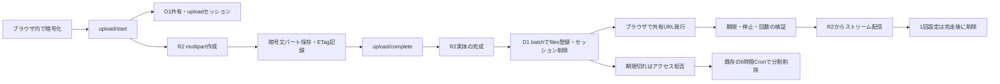

# ストレージのライフサイクルと整合性診断

期限と「1回」の共有仕様を維持し、失敗した処理の追跡情報を失わないようにした。R2とD1をまたぐ原子的なトランザクションはないため、自動処理で安全を確認できない実体は残して診断対象にする。孤立オブジェクトの自動削除、新しい削除ジョブ、永続的な失敗履歴は追加していない。本番への適用・本番データの操作は未実施。

## 保存から削除まで



- R2にはファイルの暗号文とmultipartのパートを保存する。D1には `shares`、`uploads`、`upload_parts`、`files` の既存メタデータを保存する。
- ファイル内容とファイル名の暗号化はクライアントで行う。通常共有の復号鍵はURLフラグメントに置き、今回もサーバー保存しない。パスワード共有の既存wrappedKey・keySaltの扱いも変更しない。
- startは共有を作成してmultipartを開始し、そのupload IDをD1へ登録する。D1登録に失敗した場合は、作成したmultipartのabortを試みる。
- completeはuploadTokenで認可し、期限・停止・実サイズとプラン上限を確認する。R2完了後のfiles登録・upload_parts削除・uploads削除をD1の1つのbatchへまとめた。登録条件をbatch内でも再確認する。
- 通常の保存期間は1・3・7・15・30日。「1回」は完走後の削除と7日の安全期限を維持する。未完了セッションの掃除基準も作成から24時間のまま。
- 期限前の取得、期限切れ410、停止403、欠落404、1回設定の回数消費と中断時の回復は既存の取得経路を使う。ファイル本文を診断のために復号・読出しする処理は追加しない。

## 発見した問題と修正

| 問題 | 影響 | 対応 |
| --- | --- | --- |
| multipart abortの全例外を無視 | 一時障害でもD1の追跡行を失い、再試行できなくなる | 確認済みNoSuchUploadの10024だけを不在として扱う。その他は追跡を残し、既存Cronで再試行 |
| R2完了後のD1操作が3回の独立実行 | filesだけ登録済み、あるいは完成したR2だけが残る | D1の3操作をbatchで原子化。失敗時はupload追跡を保持 |
| 完成R2の無条件な再登録 | 並行するサイズ超過処理が正常登録済み実体を削除し得る | 再登録はしない。10024時は既登録の同じ共有・storage keyのIDだけ返し、未登録なら409と追跡維持 |
| share_id単位で最後に全削除 | 削除途中に追加された未確認のファイルもcascadeで失われる | 確認したfile ID・upload IDだけを削除し、残存行がある親共有は残す |
| 1共有の取得件数・作業量が無制限 | 大きい共有でメモリ・操作数が増える | 1回1,000 files・20 uploadsに制限し、残りを次回へ持ち越す |
| 未登録の完成R2があるupload行を消す | オブジェクトの追跡手段が失われる | abort後にHEADで確認。files未登録なら行と実体を残し、要確認とする |
| 同じstorage keyを別の未確認行も参照 | 他の正常ファイルの実体を消す恐れ | 参照を検出して削除を停止。診断にも重複参照を表示 |

削除済み実体へのR2 deleteや、削除済み共有への再実行は安全に扱う。R2削除後にD1が失敗した場合も追跡行は残り、次回の同じ削除でメタデータを片付けられる。バックエンド例外の本文・upload ID・トークンは掃除ログへ出さない。

## 読み取り専用の診断

既存のCloudflare Access管理者認証を使う `GET /api/admin/storage` を追加した。管理画面は新設していない。レスポンスは `Cache-Control: no-store`。`apply=true`、`dryRun=false`、未知のパラメーターは受け付けず、書込み・abort・deleteの実装を持たない。

既存Access認証を利用してCLIから取得できる。次は手順例であり、本番への実行はしていない。

```sh
curl --fail --silent --show-error \
  -H "Cf-Access-Jwt-Assertion: ${CF_ACCESS_JWT}" \
  "${ANZDROP_ADMIN_ORIGIN}/api/admin/storage?limit=20"
```

| パラメーター | 用途 |
| --- | --- |
| `limit` | 1〜40、初期値20。HEADは同時5件まで |
| `afterFileId` | D1 filesの続き。`files.nextAfterFileId`を使用 |
| `objectCursor` | R2の続き。`objects.nextCursor`を使用 |
| `scan=files\|objects\|both` | 初期値both。片側を取り切ったら他方だけを取得し、再HEADや再LISTを避ける |
| `summary=0\|1` | 集計の省略・再取得。初回は集計し、継続ページでは既定で省略 |

返す値は次のとおり。

- `summary`: 登録ファイル数、登録平文サイズ合計、期限切れ共有・ファイル数、未完了・24時間超セッション数、回数を消費したファイル数など。本文やファイル名、復号鍵、uploadTokenは返さない。
- `files`: 対象ページのHEAD確認件数、実体欠落のfile ID、HEAD失敗で判定できなかったfile ID。通信失敗を「実体がない」とは数えない。
- `objects`: 対象ページのオブジェクト数・暗号文容量、D1のfilesにもuploadsにも対応がない疑い、uploadsだけが対応する完成実体、重複参照。内部storage keyは認証済み管理者にのみ返す。
- `candidates`: 初回ページの期限切れshare IDと古いupload ID。追加候補の有無も返す。通常は各20件まで。

**容量と件数の意味を混同しない。** D1の平文サイズ合計は登録行の集計、R2の暗号文容量は取得したページの合計であり、バケット全体の請求容量ではない。書込みと並行する診断は一貫したスナップショットにならない。孤立・欠落の疑いは再確認が必要で、削除してよいという判定ではない。

削除失敗の永続履歴は新設していないため、`deletionFailureHistoryAvailable` はfalse。失敗件数は既存Cronの `failed` を確認する。0件と推測して返さない。Cloudflare側のログ保存設定は別途確認が必要。

## 分割削除と再試行

Cronはこれまでどおり6時間ごとに期限切れ共有と24時間超のセッションを処理する。候補は既定20件×最大3バッチ、SQL文とR2操作は両フェーズ合計900単位まで。D1 batch内のSQL文も個別に数える。上限に達したら `workLimitReached` と `reachedBatchLimit` を立て、未処理行を次回へ残す。これはアプリの作業上限であり、Cloudflareプランの制限値そのものではない。`workLimit` は1〜900で調整できる。

`cleanupExpiredShares(env, { dryRun: true })` と `cleanupStaleUploads(env, { dryRun: true })` はD1候補だけを読む。R2操作もD1更新も行わず、`processed: 0` と `candidates` を返す。同じ候補を複数バッチで重複計上しない。

既存の管理DELETEは、処理が完了すれば従来どおり200。1回の上限や並行追加で残りがある場合は409・`partial: true`・`retryable: true` を返す。**期限前の管理削除はCronの期限切れ抽出に直ちには載らないため、管理者が同じ共有に対して明示的に再実行する。** 整合性確認が必要な場合は409・`retryable: false` となる。既に削除済みの共有は成功として扱う。

`failed` はサービス障害だけでなく、分割未完了・整合性確認待ちも含む。900単位の上限到達はfailedに加えず、専用フラグで示す。大きな共有や大量のバックログは複数Cronにまたがり、物理削除が遅れる。利用者のアクセス期限を延ばす変更ではないが、運用上許容する掃除遅延を本番適用前に確認する。

## コストと測定根拠

- 完了時のD1書込みは、3回のbinding往復から1回のbatchへ変更した。SQL文数・書込行数や料金が3分の1になるという意味ではない。
- `uploads(created_at,id)`、`uploads(storage_key)`、`files(storage_key)` の非一意索引を追加する。既存列だけの索引で、新しいユーザー情報を保存しない。ローカルSQLiteのEXPLAINで、旧stale抽出のSCAN＋一時ソートが索引利用へ変わることを確認した。schema変更前後のplanを別のSQLコメントで取得し、prepareキャッシュを避けている。
- 掃除の一時配列は共有全体の件数に比例させず、最大1,000 files・20 uploadsに制限した。本文は読み込まず、R2の一括削除を使う。
- 診断のR2参照照合は、取得したキー群をJSONパラメーターへまとめて1つのSQLで調べる。続きでは集計や取り切った側のスキャンを省略できる。
- 索引には保存容量・書込負荷が増える側面がある。HEADによる安全確認にも追加のR2操作が必要。削除失敗からの追跡喪失や無制限な作業を防ぐための費用であり、実請求の削減額は未測定。

## 本番適用前と残る課題

1. migration `0019` の索引追加をレビューし、バックアップと通常の適用手順を確認する。本番では今回実行していない。
2. Workers・D1の契約プラン、CPU・SQL・サブリクエスト制限、Cronの失敗とバックログを確認する。設定に明示されていない外部の契約条件を推測しない。
3. dry-runの疑いを複数回確認する。新しい孤立実体の自動削除を有効にする場合は、人間の承認を必須とする。今回その機能は実装・有効化していない。
4. R2完成後・D1失敗で残る実体、既に全てのD1追跡行を失った実体は自動復旧しない。完了状態が不明ならcompleteは409となり、新しく送信し直すか運用側で確認する。完全な自動復旧・全リクエストの同一成功応答には、別途の排他・冪等性情報の永続化設計と承認が必要。
5. startのD1失敗と補償abortが両方失敗すると、追跡されないmultipartが残り得る。Workersの通常LISTは完成オブジェクトのみで、これを網羅しない。実バケットの未完了multipartのライフサイクルを確認する。
6. 「1回」の削除に失敗した行は期限切れ共有の掃除まで残り得る。`exhaustedFiles` は配信中の予約も含み得るため、その数だけを根拠に自動削除しない。失敗履歴、last activity、ロック、専用キュー等を保存する場合は新しい永続データとして事前承認を得る。
7. 恒久的な失敗候補が処理上限以上に並ぶ場合、後続の物理削除が滞る可能性がある。今回は新しい永続カーソルやリトライ履歴を追加せず、警告と診断から運用確認できる範囲に留めた。

## 検証

Miniflareの実D1・R2を使い、正常削除、重複実行、R2成功後のD1失敗、abort障害、未登録完成実体、削除中の新規登録、1,001件の分割と管理API再実行、同時complete、サイズ補償との競合、確定時の期限変更、dry-run無変更、操作数上限、診断の認証・ページ送りを検証する。

最終検証ではVitestの158ファイル・1,626件が成功した。別の1ファイルはfork起動タイムアウトで未実行となったため、単独で再実行し7件すべて成功した（955ms）。合計159ファイル・1,633件を確認したが、最終の一括実行自体は環境エラー1件を含む。所要時間は一括3,913.45秒。直前の一括実行は、最後の診断テスト2件を追加する前の1,631件が130.25秒で成功している。診断周辺の最終再実行は35件・2.32秒だった。

ESLint、TypeScript、router型チェック、Astro check（エラー・警告0）、public/API/routerのビルドは成功した。Workersのビルドはdry-runであり、デプロイしていない。ローカルChromiumの既存E2Eは通常送信・パスワード付き送信・ZIPダウンロードの3件が49.4秒で成功した。今回Firefox・WebKitや実端末での追加検証は行っていない。

本番データでの整合性件数、料金、スループットや削除遅延の実測は行っていない。

## 参照した一次資料

- [R2 Workers API](https://developers.cloudflare.com/r2/api/workers/workers-api-reference/): multipartは他リクエストでも完了・中断され得る。
- [R2エラーコード](https://developers.cloudflare.com/r2/api/error-codes/): Workers APIの例外末尾の数値コードとNoSuchUploadの扱い。
- [D1 Database](https://developers.cloudflare.com/d1/worker-api/d1-database/): batchのトランザクションとエラー時のロールバック。
- [Workers limits](https://developers.cloudflare.com/workers/platform/limits/): 契約・設定に応じた実行制限。コードの古い一律1,000上限の説明は削除した。
